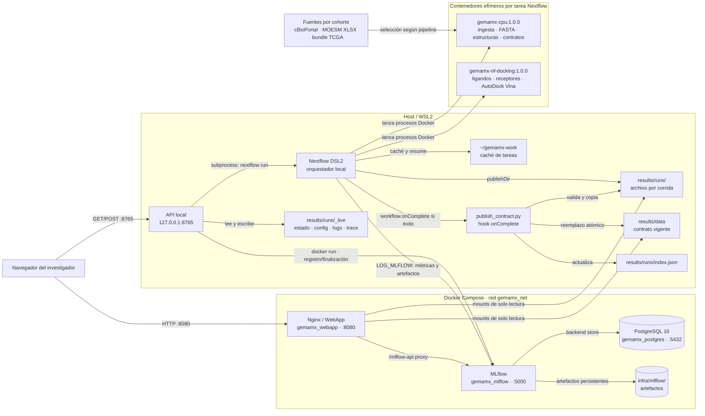

# Arquitectura de contenedores — GEMA MX

**Alcance:** stack local Docker Compose, API de control, ejecución Nextflow DSL2 y persistencia de resultados. La descripción corresponde al despliegue Windows + WSL2 usado por el proyecto; no es una receta de producción.

## Vista general



La API de control y el motor Nextflow no son servicios de `docker-compose`: se ejecutan en el host/WSL. Docker Compose mantiene los servicios de datos y la interfaz; Nextflow crea y elimina contenedores por proceso.

## Servicios y puertos

| Componente | Ejecución | Puerto publicado | Responsabilidad y persistencia |
|---|---|---:|---|
| `postgres` / `gemamx_postgres` | Docker Compose, `postgres:16.4-bookworm` | `5432` | Backend store de MLflow. Usa el volumen nombrado `gemamx_pgdata`; `docker compose down` lo conserva. |
| `mlflow` / `gemamx_mlflow` | Docker Compose, imagen propia con MLflow 2.19 | `5000` | Tracking API/UI, parámetros, métricas y artefactos. Depende del healthcheck de PostgreSQL. Monta `infra/mlflow/artifacts` y `infra/mlflow/mlartifacts`. |
| `webapp` / `gemamx_webapp` | Docker Compose, Nginx 1.27 Alpine | `8080` (contenedor `80`) | SPA estática. Monta `results/data`, `results/runs` y `structures/external` como solo lectura; proxya `/mlflow-api/` a MLflow. |
| API de control | Proceso Python en host/WSL, iniciado con `bash run_pipeline_api.sh` | `127.0.0.1:8765` | Lista pipelines permitidos, valida parámetros, estima carga, registra configuración y controla el proceso Nextflow. Escribe estado, configuración, log y trace en `results/runs/_live/`. |
| `cpu-base` | Servicio de build bajo el perfil Compose `images`; no es servicio persistente | — | Construye `gemamx-cpu:1.0.0`, base de los procesos Nextflow de CPU y de `LOG_MLFLOW`. Incluye Python, Biopython, RDKit, Meeko, Open Babel y AutoDock Vina. |
| `docking` | Servicio de build bajo el perfil Compose `images`; no es servicio persistente | — | Construye `gemamx-nf-docking:1.0.0`, derivada de la imagen CPU. Se asigna a preparación de ligandos/receptores, centros de caja y docking Vina. |

La red `gemamx_net` permite que Nginx y los contenedores Nextflow resuelvan MLflow mediante `gemamx_mlflow:5000`, y PostgreSQL mediante `postgres:5432`. El navegador usa los puertos publicados en el host.

## Ejecución de pipelines

La API local acepta solo cuatro configuraciones registradas; no recibe comandos arbitrarios:

| Identificador | Entry point | Fuente de datos |
|---|---|---|
| `tcga-v1` | `main.nf` | cBioPortal TCGA-BRCA o snapshot local opcional. |
| `romero-v2` | `main_v2.nf` | MOESM8/9 para mutaciones/drivers y MOESM4 para clínica. |
| `romero-v2_1` | `main_v2_1.nf` | Cohorte Romero; flujo estructural V2.1, sitio de unión y mapa fármaco-diana. |
| `tcga-v3` | `main_v3.nf` | Bundle TCGA-Hispanic validado antes de ingesta. |

La SPA consulta `/api/v1/options`, `/api/v1/estimate`, `/api/v1/status` y `/api/v1/start`. Al iniciar, la API valida la configuración y evita ejecuciones concurrentes; registra parámetros en MLflow con un contenedor auxiliar `gemamx-cpu:1.0.0` y lanza `nextflow run` como proceso del host. El monitor actualiza `status.json` y sirve el tail del log y de la traza a Pipeline Status.

Nextflow orquesta el DAG y ejecuta tareas en los contenedores configurados. De forma general, la ruta científica es:

1. Ingesta y priorización de variantes; opcionalmente, validación de bundle y metadatos clínicos.
2. Obtención o reutilización de FASTA WT/MUT.
3. Predicción/reutilización de estructuras y alineamiento WT-mutante.
4. Preparación de ligandos/receptores, cálculo de la caja y ejecución AutoDock Vina.
5. Construcción de JSON, estructuras y resultados clínicos.
6. Escritura del manifiesto y registro de métricas/artefactos en MLflow.

Los parámetros `image_cpu`, `image_docking` e `image_mlflow` se definen en `nextflow.config`. La configuración de GPU/Boltz se documenta por separado en [BOLTZ_HPC.md](BOLTZ_HPC.md); el `docker-compose.yml` de este stack no construye una imagen GPU.

## Ciclo de publicación y datos

```text
Tareas Nextflow
  └─ BUILD_JSONS / PUBLISH
       └─ results/runs/<runName>/data + run_manifest.json
            └─ workflow.onComplete (solo si la corrida terminó bien)
                 └─ publish_contract.py en el host
                      ├─ valida los contratos requeridos
                      ├─ reemplaza results/data de forma atómica
                      ├─ actualiza results/runs/index.json
                      └─ reinicia gemamx_webapp si está habilitado
```

| Ruta | Uso | Consumidor |
|---|---|---|
| `~/gemamx-work` | Caché de tareas Nextflow y soporte de `-resume`; no es archivo de resultados. | Nextflow |
| `results/runs/<runName>/` | Archivo persistente de cada corrida, con datos y manifiesto. | Auditoría y selector histórico |
| `results/runs/index.json` | Índice de corridas publicadas. | SPA y Nginx |
| `results/data/` | Contrato vigente de la última corrida exitosa. | SPA, en modo lectura |
| `results/runs/_live/` | Estado y configuración de ejecución, log y trace del API. | API de control y vista Pipeline Status |
| `infra/mlflow/artifacts/`, `infra/mlflow/mlartifacts/` | Artefactos de tracking. | MLflow |
| Volumen `gemamx_pgdata` | Base de datos de tracking. | PostgreSQL / MLflow |

El hook solo promueve resultados si Nextflow marca éxito. Si la validación del árbol falla o la corrida falla, el contrato vigente anterior permanece. La promoción cambia el directorio `results/data`; por eso el hook reinicia Nginx para que el bind mount apunte al árbol nuevo. El archivado por corrida se puede desactivar en perfiles de humo.

## Arranque y operación local

1. Construir primero la imagen base y después la imagen de docking:

   ```bash
   docker compose --profile images build cpu-base
   docker compose --profile images build docking
   ```

2. Levantar los tres servicios persistentes:

   ```bash
   docker compose up -d
   ```

3. En WSL, iniciar la API local en una terminal que permanezca abierta:

   ```bash
   bash run_pipeline_api.sh
   ```

4. Abrir la WebApp en `http://localhost:8080` y MLflow en `http://localhost:5000`.

Para detener el stack se usa `docker compose down`. Evita `docker compose down -v` si se desea conservar el volumen PostgreSQL. Los reportes locales de Nextflow quedan bajo `results/pipeline_info/`.

## Límites y seguridad

- La API de control escucha en `127.0.0.1:8765` y restringe CORS a `localhost:8080` y `127.0.0.1:8080`; la configuración de pipelines está allow-listed.
- `results/data`, `results/runs` y `structures/external` se montan como solo lectura en Nginx. La escritura de resultados pertenece al pipeline/publicador, no a la WebApp.
- Compose publica PostgreSQL, MLflow y Nginx en el host. Antes de exponerlos fuera de una máquina de desarrollo se deben restringir los puertos y configurar controles de acceso.
- `docker-compose.yml` contiene `POSTGRES_PASSWORD: change-me` como valor de desarrollo. Debe reemplazarse y gestionarse fuera del archivo antes de cualquier despliegue compartido.
- El API local no es un servicio Compose ni queda disponible en `gemamx_net`; las tareas y el stack sí comparten la red Docker indicada.

## Configuración de referencia

- [docker-compose.yml](../docker-compose.yml)
- [nextflow.config](../nextflow.config)
- [docs/ALMACENAMIENTO.md](ALMACENAMIENTO.md)
- [API local](../bin/pipeline_control_api.py)
- [Publicación del contrato](../bin/publish_contract.py)
- [Configuración Nginx](../webapp/nginx.conf)
